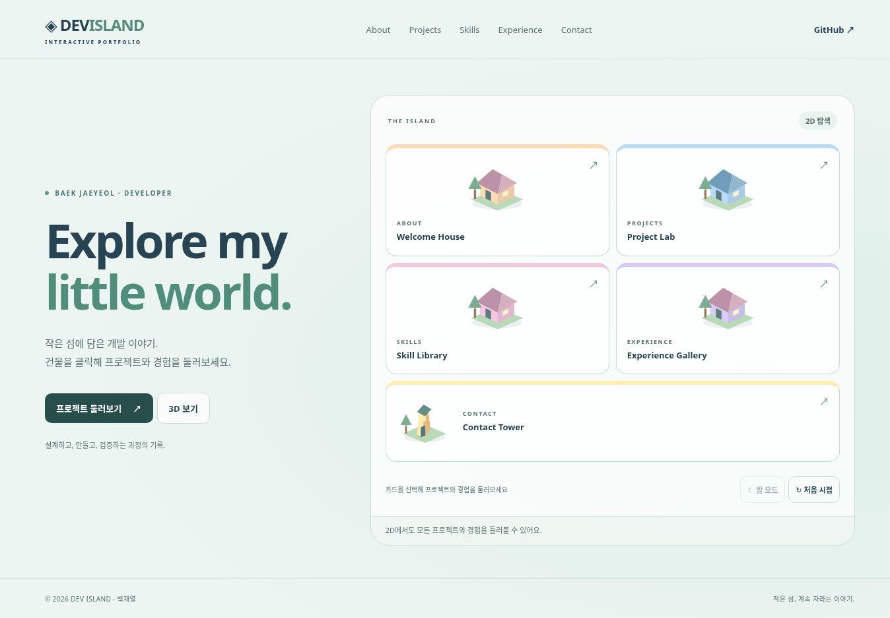

# Dev Island — 3D Developer Portfolio

파스텔 Low Poly 스타일의 3D 미니어처 섬 포트폴리오입니다. 다섯 건물을 클릭해 자기소개, 프로젝트, 기술, 경험, 연락처를 탐색합니다.

## 기술 스택
React 19 · TypeScript · Vite · React Three Fiber · Drei · Three.js

## 실행
Node.js 22 이상에서:
```bash
npm ci
npm test
npm run build
npm run dev
```

## 기능
- 마우스 드래그로 카메라 회전, 스크롤 확대
- 건물 선택 및 카메라 포커스
- 프로젝트 상세 패널
- 낮/밤 모드, 2D 보기, 모바일 반응형
- 로컬 검사와 Vercel 배포 설정

## 개발 상태
현재 버전은 **절차적 Three.js 지오메트리**로 다섯 건물을 렌더링하며 GLB 파일이 필요하지 않습니다. 장면 데이터는 `src/places.mjs`, 렌더러는 `src/World.tsx`에 있습니다.

- `npm run check`: 필수 파일 검사, Node 테스트, TypeScript 검사, 프로덕션 빌드
- 3D 렌더러 지연 로딩, 외부 글꼴 요청 없는 HTML 건물 이름표
- WebGL2 미지원·장면 오류·컨텍스트 손실 시 2D 카드 전환
- 네이티브 dialog로 상세 화면 키보드 포커스 제한 및 Escape 닫기
- 모션 줄이기 설정 시 섬 부유와 카메라 이동 애니메이션 생략

- 소개·탐색 영역을 분리한 반응형 레이아웃과 자체 SVG 건물 안내 그림
- 창문·출입문·등대·산책로·연못을 추가한 3D 장면

## 화면 확인

아래 캡처는 WebGL 미지원 환경의 **2D 대체 화면**입니다. 실제 3D 렌더링 검증과 구분합니다.



[390px 모바일 화면](docs/screenshots/mobile-390.jpg)

실행 결과와 미확인 항목은 [검증 기록](VALIDATION.md)을 참고하세요. GitHub Actions 실행에는 사전 확인이 필요합니다.

## 저장소
https://github.com/BaekJaeYeol/dev-island
